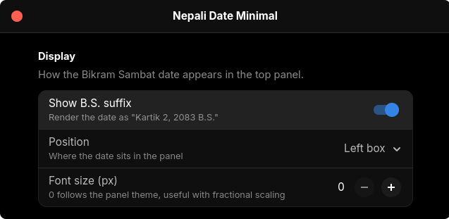

<div align="center">
  <h3>Nepali Date Minimal</h3>
  <p>A minimal GNOME Shell extension showing the Nepali (Bikram Sambat) date in the top panel.</p>
</div>

---

### Overview

A small date label in the top bar, rendered fully offline.

<p align="center">
	
	
</p>

### Requirements

- GNOME Shell 50 (not tested on lower versions)

### Installation

Clone the repository directly into your GNOME extensions directory:

```bash
git clone https://github.com/ITx-prash/nepali-date-minimal.git ~/.local/share/gnome-shell/extensions/nepali-date-minimal@itx-prash
```

> [!IMPORTANT]
> If you are on **Wayland**, you **must** log out and log back in for the system to recognize the new extension. GNOME 50 has no X11 session, so the `Alt`+`F2` shell restart is gone too.

Once the shell is restarted or you log back in, enable the extension:

```bash
gnome-extensions enable nepali-date-minimal@itx-prash
```

### Options

<p align="center">
	
</p>

<p align="center">
	
</p>

<p align="center">
	<em>Crafted with 💚 on GNU/Linux</em>
</p>

<p align="center">
	Copyright &copy;2026 <a href="https://github.com/ITx-prash" target="_blank">Prashant Adhikari</a>
</p>

<p align="center">
	<a href="https://github.com/ITx-prash/nepali-date-minimal/blob/main/LICENSE"></a>
</p>
